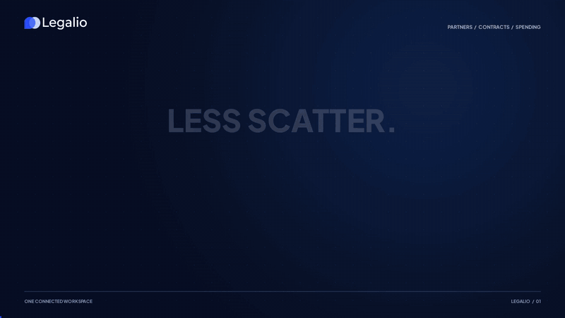
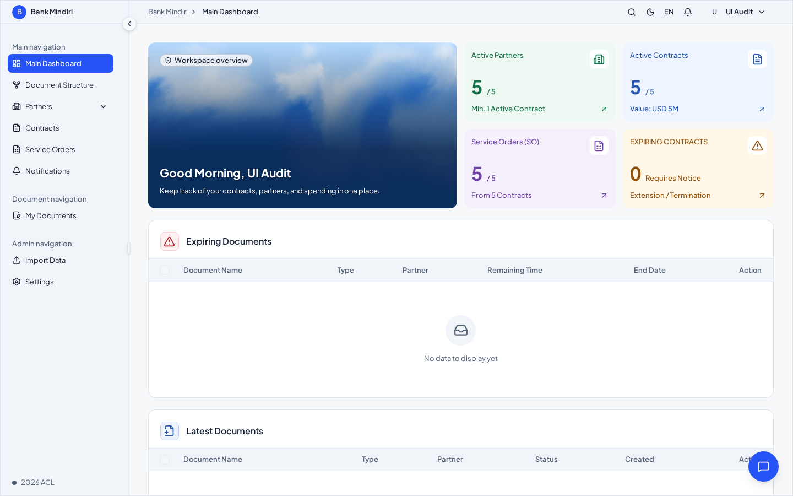
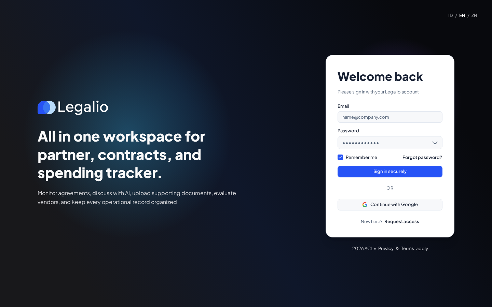
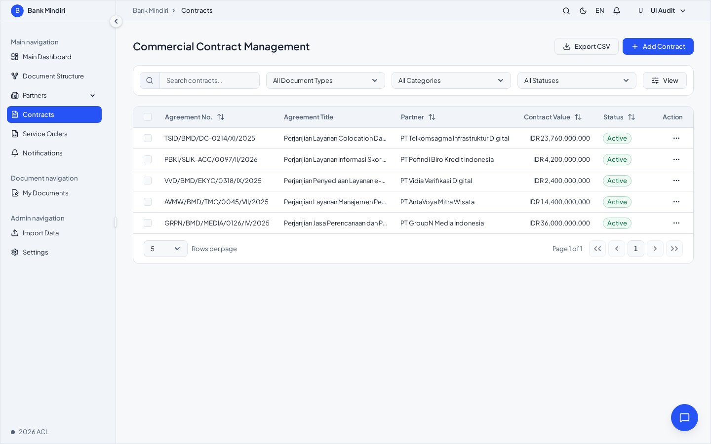
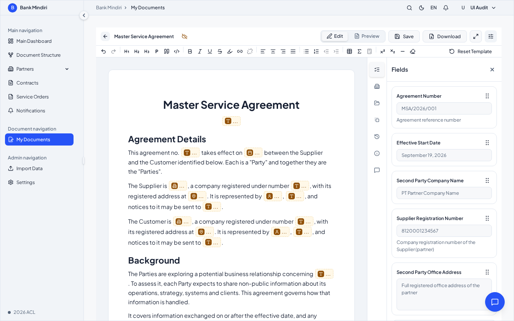
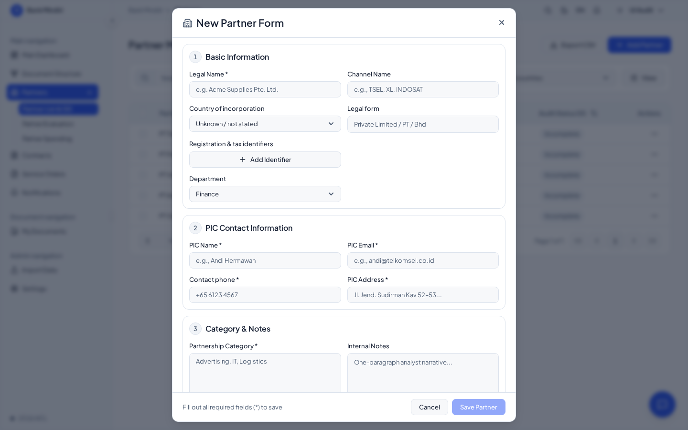
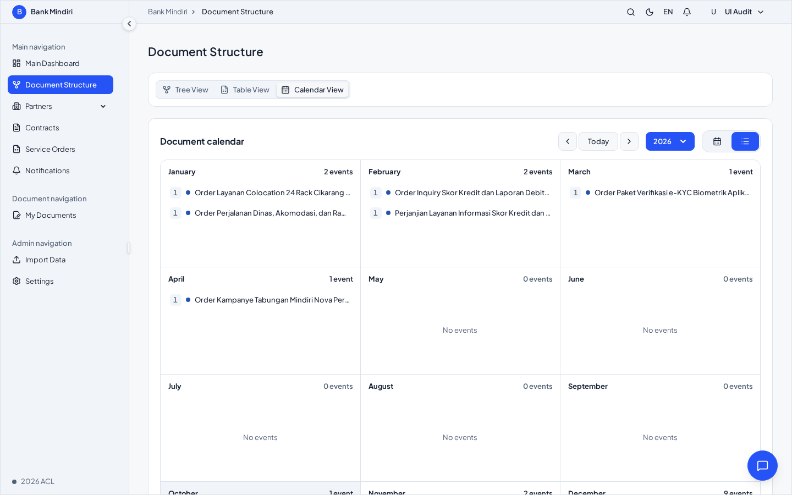

# 📦 Legalio CLM

[](package.json)
[](tsconfig.json)
[](apps/frontend/package.json)
[](turbo.json)
[](POSTGRES_STORAGE.md)
[](#-feedback-and-contributing)

[](assets/video/legalio-intro.mp4)

**[Watch the 15-second film with music and sound effects](assets/video/legalio-intro.mp4)** · [Visit Legalio](https://legalio.web.id/) · [Video transcript](assets/video/README.md#on-screen-script)


## 🌟 Highlights

- **One workspace for partners, contracts and spending**: partners with due diligence, evaluations and invoices; contracts and service orders with notice periods, renewal and termination tracking.
- **Contract editor**: start from a blank page or a template, fill fields from a side panel, and keep autosaved versions with compare, restore and redlining.
- **Document calendar**: contract starts, cancellation notices, ends, renewals and terminations on a yearly calendar.
- **Workspace search**: search a vendor name to find related contracts, service orders/IOs, spending invoices and partner evaluations within your access. Select a result to open its details or the matching spending list.
- **Multi-tenant with role-based access**: organizations, departments and roles (admin, manager, editor, viewer), enforced on the server.
- **AI assistance**: Google Gemini reads contracts, partner documents and invoices, drafts due diligence notes and generates templates.
- **Standalone system console** (`/sys`) for superusers: accounts, organizations, Tencent COS file storage, AI model, SMTP and UI texts.
- **English, Bahasa Indonesia and Simplified Chinese** out of the box.


## ℹ️ Overview

Legalio is a contract lifecycle management (CLM) application for legal, procurement and finance teams who track many partners at once. It keeps every partner, contract, service order, invoice and evaluation in one place. It reminds you before notice periods run out and gives each organization its own workspace, branding and access rules.

The app runs as a single Node.js server backed by PostgreSQL, with uploaded files stored in Tencent COS. The Docker setup includes PostgreSQL, so it can be self-hosted on one machine. See [POSTGRES_STORAGE.md](POSTGRES_STORAGE.md) for storage and backup details. The interface is built with React 19 and a design system based on [Moduix](https://moduix.dev) (Ark UI) components, sized on a golden-ratio scale.





### ✍️ Authors

Built and maintained by [adhityacl](https://github.com/adhityacl).


## 🚀 Usage

Start the app and open **http://localhost:3000**:

```bash
npm run dev
```

On the first visit, onboarding takes two steps:

1. **Connect PostgreSQL** (host, port, user, password, database, SSL). This step
   is skipped when `DATABASE_URL` is set, as in Docker. The app creates its
   schema and starts without a restart.
2. **Confirm the website's public URL, create the superuser account and enter
   the Tencent COS bucket** (SecretId, SecretKey, bucket, region and optional
   prefix) used for uploaded files. The bucket is tested before it is saved.

The URL starts with the address you opened; include `http://` or `https://` and
the public port if needed. Setup saves it in the installation database and
applies it to authentication immediately, without a restart. If you enter a
different URL, setup sends you there to sign in. A demo workspace
(*Bank Mindiri*, with five partners and their contracts) is loaded so you can
explore right away.

| Sign in | Contracts |
| --- | --- |
|  |  |

| Contract editor | New partner form |
| --- | --- |
|  |  |

| Document calendar |
| --- |
|  |

The system console for superusers is at **http://localhost:3000/sys**.


## ⬇️ Installation

Requirements: **Node.js 20.19 or newer** (22 LTS recommended) and npm, **PostgreSQL 14 or newer** (or the `postgres` service in `compose.yaml`) and a **Tencent COS bucket** for uploaded files. It runs on Linux, macOS and Windows (WSL).

```bash
git clone https://github.com/adhityacl/NEW-CLM.git
cd NEW-CLM
npm install
npm run dev
```

`npm install` also creates `apps/backend/.env` with a random `BETTER_AUTH_SECRET`. Keep that secret: it also encrypts the stored COS credentials. The database connection is entered on the first visit, or set with `DATABASE_URL` in `apps/backend/.env`. The Gemini key, SMTP and Google credentials are set later from the system console.

For production, the quickest route is Docker. The workspace is served on **http://localhost:8080**. PostgreSQL runs as the `postgres` service and its data lives in the `legalio-pg` volume. **`POSTGRES_PASSWORD` is required**: Compose refuses to start without it. Copy `.env.example` to `.env` in the repository root and set a strong value (`openssl rand -base64 24`), or export it in your shell, before the first start. (An existing install that started with the old default must set `POSTGRES_PASSWORD=legalio` to keep its current database.) `FRONTEND_BIND` / `FRONTEND_PORT` choose the published address (default `0.0.0.0:8080`; use `127.0.0.1` behind a host reverse proxy):

```bash
cp .env.example .env   # then set POSTGRES_PASSWORD
npm run setup
docker compose up --build
```

The first visit shows the one-time setup page that creates the administrator. It is open to whoever reaches the URL first by design, so complete it before you expose the address publicly. Backups, restore, deployment and rollback are in [docs/RUNBOOK.md](docs/RUNBOOK.md).

First-run onboarding stores the website URL in the database, including for
Docker installations. `BETTER_AUTH_URL` is an optional deployment override and
takes priority over the onboarding value. Existing installations without a
stored URL continue to detect the request's origin.

To set the override manually, pin authentication to the URL users open by adding
`BETTER_AUTH_URL` to `apps/backend/.env`. Use the exact URL users open, including
the scheme and public port if applicable. From the repository root, ensure the
environment file exists and open it in a text editor:

```bash
npm run setup
nano apps/backend/.env
```

Find `# BETTER_AUTH_URL=`, remove the leading `#`, and fill in the URL. If an
active `BETTER_AUTH_URL=` line already exists, edit that line instead of adding
a duplicate. If neither line exists, add one. Replace `<YOUR_PUBLIC_URL>` below
with your installation's actual public URL; do not keep the angle brackets:

```dotenv
BETTER_AUTH_URL=<YOUR_PUBLIC_URL>
```

Leave the other settings, including `BETTER_AUTH_SECRET`, unchanged. In nano,
save with **Ctrl+O**, press **Enter**, then exit with **Ctrl+X**. You can use
another text editor if nano is not installed.

After changing `.env`, recreate the backend container so it receives the updated
environment (a container restart alone does not reload `env_file`):

```bash
docker compose up -d --force-recreate backend
```

If login reports `Invalid origin` when using a public port, ensure nginx forwards
`Host $http_host`, which includes that port. The bundled nginx template does this
for `/api`, `/uploads`, and `/sys`. Rebuild the frontend image to apply template
changes with `docker compose up -d --build frontend`. When using your own nginx
configuration, preserve the public host and port there too.

Without Docker, run `npm run build`, then start the API with `NODE_ENV=production npm start` (set `DATABASE_URL` or use the onboarding form). Serve `apps/frontend/dist` from a web server such as nginx, and proxy `/api`, `/uploads` and `/sys` to port 3000.


## 💭 Feedback and Contributing

Found a bug or have an idea? Open an [issue](https://github.com/adhityacl/NEW-CLM/issues) or start a conversation in [Discussions](https://github.com/adhityacl/NEW-CLM/discussions).

Contributions are welcome: fork the repository, create a branch, and open a pull request against `main`. Please keep changes focused and describe what you tested.

Legalio is released under the MIT license.
